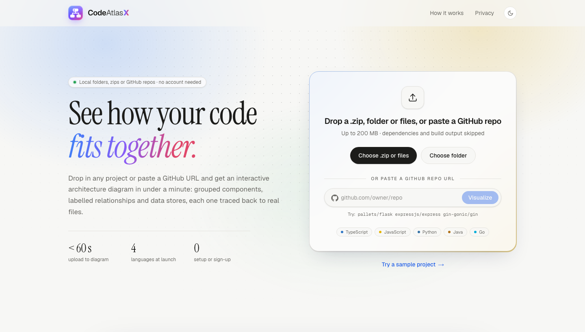
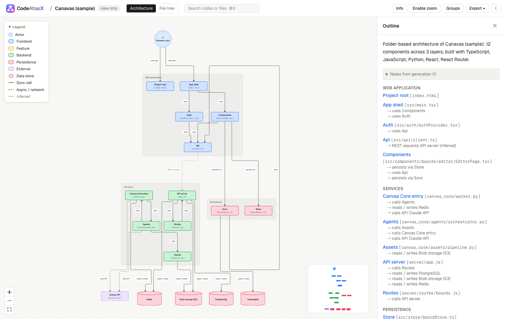
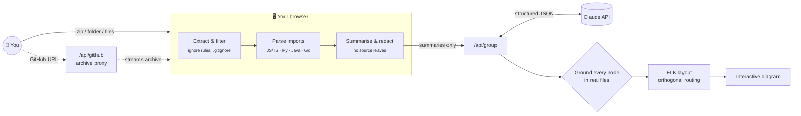

<div align="center">


# CodeAtlasX

### See how your code *fits together.*

Drop in a project, or paste a GitHub URL, and get an **interactive architecture diagram in under a minute**: grouped components, labelled relationships and data stores, each one traced back to real files.

<p>
  
  
  
  
  
</p>

<a href="https://codeatlasx.vercel.app"><b>🌐 Live demo</b></a> ·
<a href="#-quick-start"><b>Quick start</b></a> ·
<a href="#-features"><b>Features</b></a> ·
<a href="#-how-it-works"><b>How it works</b></a> ·
<a href="#-privacy--security"><b>Privacy</b></a> ·
<a href="#%EF%B8%8F-configuration"><b>Configuration</b></a>

<br />

<picture>
  <source media="(prefers-color-scheme: dark)" srcset="docs/images/landing-dark.png" />
  
</picture>

</div>

---

## 🧭 Why CodeAtlasX?

Understanding an unfamiliar codebase usually means reading dozens of files just to learn **what calls what**. Tools like GitDiagram help, but only for public GitHub repositories.

CodeAtlasX also works with **local, private and zipped projects**: student work, client handovers and legacy code.

> A 140 MB upload with **6,882 files** contains only **~290 real source files**. CodeAtlasX removes `node_modules/`, `.venv/` and build output automatically, then finds the architecture: a React front end, a Python agent pipeline and their data stores.

<div align="center">
<picture>
  <source media="(prefers-color-scheme: dark)" srcset="docs/images/diagram-dark.png" />
  
</picture>
<sub><i>The built-in sample project: actors at the top, layered groups in the middle, data stores at the bottom.</i></sub>
</div>

---

## ✨ Features

<table>
<tr>
<td width="50%" valign="top">

#### 📦 Upload anything
- **.zip** files up to 200 MB, **whole folders** dragged in, or **loose files**
- **GitHub URLs**, including `…/tree/branch/sub/folder`
- Example repos you can try with one click, plus a built-in sample project

</td>
<td width="50%" valign="top">

#### 🧹 Strips the noise
- Skips `.git`, `node_modules`, `.venv`, `dist`, `build`, `.next`, lockfiles and binaries
- Applies your project's own **`.gitignore`**
- **Scan preview** with counts and editable ignore rules
- Folder picker for projects over 5,000 files

</td>
</tr>
<tr>
<td valign="top">

#### 🔍 Real static analysis
- Parses imports for **JS/TS, Python, Java and Go** into a file-level dependency graph
- Resolves `tsconfig` path aliases, Python packages, Java packages and Go modules
- Detects **entry points, routes** (Express, FastAPI, Flask, Next.js, Spring…), **databases** (Prisma, SQLAlchemy, Mongoose, Postgres, Redis, IndexedDB…) and **external APIs**

</td>
<td valign="top">

#### 🧠 Grounded AI grouping
- Claude groups files into named components with short verb labels on each relationship ("routes auth", "stores thumbnails")
- **Every box must map to real files.** Paths that aren't in the upload are rejected.
- Relationships are drawn **solid** when confirmed by imports and *muted* when inferred
- Falls back to folder-based grouping when no API key is set

</td>
</tr>
<tr>
<td valign="top">

#### 🗺️ Interactive diagram
- Auto-layout with **orthogonal routing** and **line-jump arcs** where lines cross
- **Hover cards** explaining what each box does and why it's there
- Click a box to see its description, files and **syntax-highlighted source**
- Search (<kbd>⌘</kbd><kbd>K</kbd>), minimap, zoom, drag, rename, hide or collapse groups

</td>
<td valign="top">

#### 📤 Export and share
- **PNG, SVG, PDF**, **Mermaid** source and raw JSON
- **Private view-only links**: stored for 30 days, or carried inside the URL on serverless hosts
- **File tree view** with a treemap coloured by language
- **Light and dark** themes, plus an accessible text outline of the whole diagram

</td>
</tr>
</table>

### Diagram language

| Element | Shape | Example |
|---|---|---|
| 🔵 **Actor** | Circle | Browser user, scheduled caller |
| 🟦 **Frontend component** | Blue rectangle | App routes `[App.tsx]` |
| 🟨 **Feature module** | Yellow rectangle | Editor page `[EditorPage.tsx]` |
| 🟩 **Backend service** | Green rectangle | Express API router `[app.ts]` |
| 🟥 **Persistence** | Pink rectangle | File storage `[storage.ts]` |
| 🛢️ **Data store** | Cylinder | PostgreSQL, IndexedDB, S3 |
| 🟪 **External service** | Dashed rectangle | Stripe, Claude API |
| ➡️ **Sync call** | Solid arrow + verb | "checks board rules" |
| ⇢ **Async / network** | Dotted arrow + verb | "REST requests" |

---

## 🚀 Quick start

```bash
git clone https://github.com/vikask-iitg/codeatlasx.git
cd codeatlasx
npm install

# Optional: enables AI grouping (without it, files are grouped by folder)
export ANTHROPIC_API_KEY=sk-ant-...

npm run dev            # → http://localhost:3000
```

Then click **"Try a sample project"**, drop in a `.zip`, or paste a repo like `pallets/flask`.

<details>
<summary><b>Production build</b></summary>

```bash
npm run build
npm start              # or: PORT=3100 npm start
```

</details>

<details>
<summary><b>Deploy to Vercel</b></summary>

[](https://vercel.com/new/clone?repository-url=https%3A%2F%2Fgithub.com%2Fvikask-iitg%2Fcodeatlasx&env=ANTHROPIC_API_KEY&envDescription=Optional%3A%20enables%20AI%20grouping%20with%20Claude)

Or from the CLI:

```bash
vercel            # preview deployment
vercel --prod     # production
```

Add `ANTHROPIC_API_KEY` (and optionally `GITHUB_TOKEN`) under **Project → Settings → Environment Variables**. Vercel has no persistent disk, so share links there are **self-contained**: the compressed diagram is stored in the URL fragment, so no database is needed and links never expire.

</details>

<details>
<summary><b>Pipeline smoke test (no browser)</b></summary>

```bash
npm run smoke
```

Runs the sample project through scan → analysis → grouping → layout → Mermaid and prints the result.

</details>

---

## 🔬 How it works



1. **Extract.** Archives are unpacked **in your browser**. Path traversal (`../`), symlinks and zip bombs (over 100:1 compression) are rejected.
2. **Filter.** Default ignore rules plus your `.gitignore` reduce thousands of files to the ones that matter.
3. **Parse.** Imports are resolved into a file-level dependency graph. Manifests (`package.json`, `requirements.txt`, `pom.xml`, `go.mod`, Docker files…) reveal the stack.
4. **Group.** Compact per-file summaries go to Claude, which returns structured JSON: components, groups and labelled relationships.
5. **Verify.** Every box must cite real files. Invalid paths are dropped, the request is retried once with feedback, and relationships are checked against the import graph.
6. **Draw.** ELK.js places components top-to-bottom (actors, then layers, then data stores) and React Flow renders the interactive diagram.

---

## 🔒 Privacy & security

| | |
|---|---|
| 🏠 **Parsed locally** | Uploads and GitHub archives are unpacked and analysed in the browser tab. Code is **never executed**. |
| ✂️ **Summaries, not source** | Claude receives file paths, line counts, function and class names, imports, short doc comments and a README excerpt. Never whole files. |
| 🙈 **Secrets redacted** | `.env` and key files are skipped, and API keys, tokens, JWTs, private keys and connection strings are removed before anything is sent. |
| 🗑️ **Nothing kept by default** | Source disappears when you close the tab. Only the diagram JSON is stored, and only if you create a share link (30-day expiry, or self-contained in the URL on serverless hosts). |
| 🚫 **No training** | Uploads are not used to train models. |

---

## ⚙️ Configuration

| Variable | Default | Purpose |
|---|---|---|
| `ANTHROPIC_API_KEY` | – | Turns on AI grouping with Claude. Without it, files are grouped by folder. |
| `CLAUDE_MODEL` | `claude-opus-5-5` | Model used for grouping. |
| `CV_DISABLE_LLM` | – | Set to `1` to always use folder-based grouping. |
| `GITHUB_TOKEN` | – | Lets you import **private repos** and raises GitHub's rate limit (about 60 downloads an hour without a token). |
| `CV_DATA_DIR` | `./.data` | Where share links and feedback are saved. On Vercel, share links are self-contained unless you set this to durable storage. |

### Limits

| Limit | Value |
|---|---|
| Compressed upload | 200 MB |
| Extracted size | 1 GB |
| Compression ratio | 100 : 1 |
| Files analysed | 5,000 (pick sub-folders above that) |
| Single text file | 1 MB |
| Diagram size | 10–35 boxes; groups collapse automatically above that |

---

## 🗂️ Project structure

```
src/
├── app/
│   ├── page.tsx                 # Landing → scan → analyse → viewer
│   ├── share/[id]/              # Read-only shared diagrams
│   └── api/
│       ├── group/               # Claude grouping, verification, fallback
│       ├── github/              # GitHub archive proxy (streamed, size-capped)
│       ├── share/               # Create / fetch share links
│       └── feedback/            # 👍 / 👎 accuracy ratings
├── components/
│   ├── Landing.tsx              # Hero, upload card, GitHub input
│   ├── Home.tsx                 # Upload flow, scan preview, progress
│   ├── Viewer.tsx               # Toolbar, search, export, regenerate
│   ├── SidePanel.tsx            # Details, files, code preview, outline
│   ├── FileTreeView.tsx         # Collapsible tree + language treemap
│   └── diagram/                 # React Flow nodes, routed edges, hover cards
└── lib/
    ├── ingest.ts                # Zip / folder reading, limits, scan
    ├── ignore.ts                # gitignore-style rule engine
    ├── analyze.ts               # Imports, stack, routes, DBs, redaction
    ├── heuristic.ts             # Folder-based fallback grouping
    ├── diagramSchema.ts         # Output schema + grounding of nodes in real files
    ├── layout.ts                # ELK layout, line-jump path builder
    ├── mermaid.ts · export.ts   # Exporters
    └── github.ts                # GitHub URL parsing & links
```

---

## 🛣️ Roadmap

- [x] Zip, folder and file upload with automatic noise filtering
- [x] Import graphs for JS/TS, Python, Java and Go
- [x] Grouping with Claude, plus folder-based fallback
- [x] Interactive diagram, hover cards, side panel, file tree view
- [x] PNG / SVG / PDF / Mermaid export and share links
- [x] GitHub URL import
- [ ] `.tar.gz` and `.7z` uploads
- [ ] Tree-sitter parsing for more languages
- [ ] Accounts and diagram history
- [ ] GitLab import, monorepo per-package views, team workspaces

---

## 🧱 Tech stack

**Next.js 16** · **React 19** · **TypeScript** · **Tailwind CSS 4** · **React Flow** · **ELK.js** · **Shiki** · **JSZip** · **html-to-image** · **jsPDF** · **Anthropic SDK** · **Zod**

<div align="center">
<br />

<br />
<sub><b>CodeAtlasX</b>: architecture diagrams for any codebase, whether it's local, private or on GitHub.</sub>
</div>
